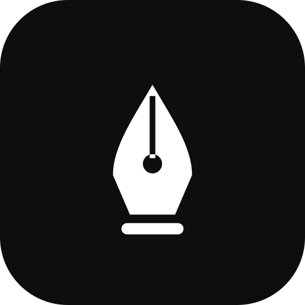
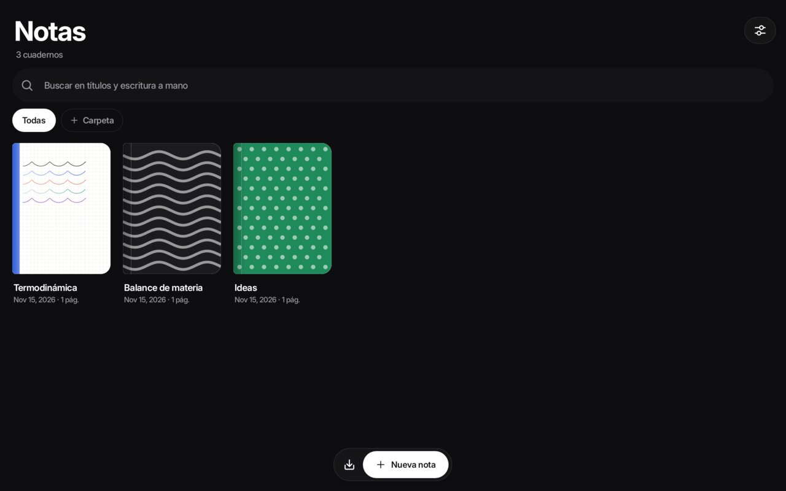
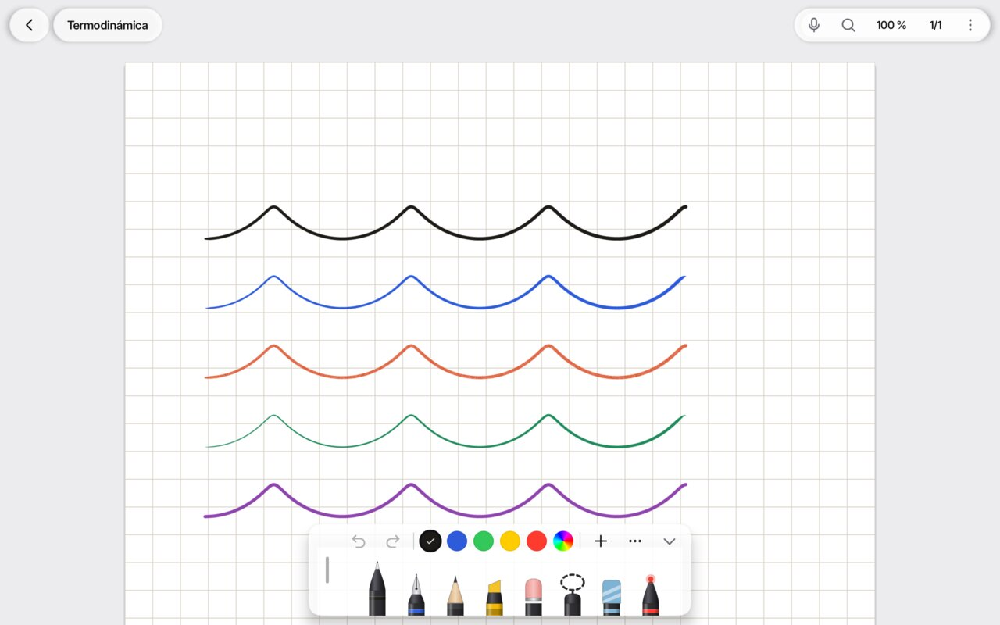
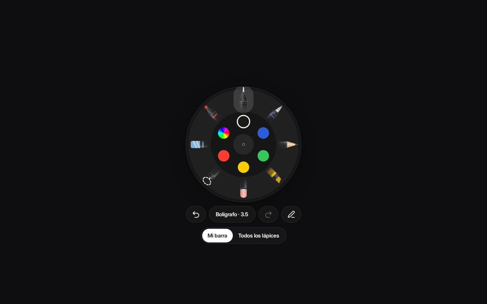
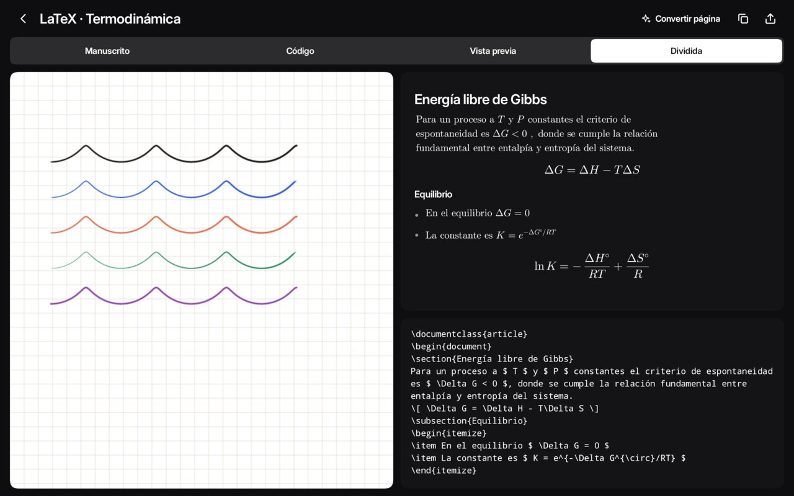
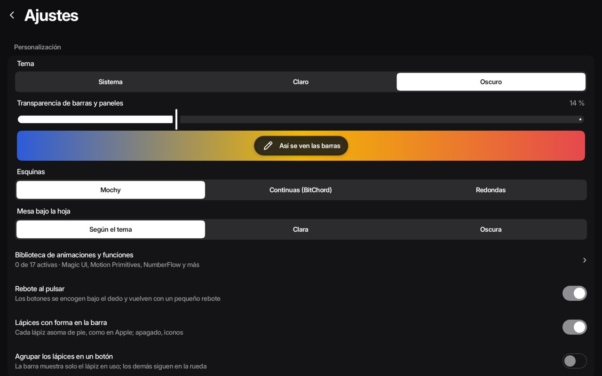

  

<h1 align="center">ArsNova</h1>

  <b>Notas a mano para Android, con lápices de verdad.</b> 
  Para tablet y teléfono, en la línea de Notability, Goodnotes, Noteshelf y StarNote. 
  Tinta nativa, LaTeX y búsqueda en tu letra, sin anuncios.

  
  
  
  

  <a href="https://github.com/Saerling/ArsNova/releases/latest"><b>⬇ Descargar el APK</b></a>
  &nbsp;·&nbsp;
  <a href="#instalar">Instalar con Orion Store</a>
  &nbsp;·&nbsp;
  <a href="#funciones">Funciones</a>

  
  

---

## Funciones

<table>
<tr>
<td width="50%" valign="top">

### ✍️ Tinta
Cada lápiz tiene su carácter: bolígrafo, pluma, lápiz, pincel, monolínea, caligrafía de plumilla plana y resaltador. Lo que ves al escribir es lo que queda al levantar el lápiz. Baja latencia con predicción del trazo y lienzo nítido con mucho zoom.

### 🎛 Rueda del lápiz
Con un doble toque del lápiz se abre un dial bajo la punta. Lo giras para cambiar de herramienta o de grosor, y ahí también tienes colores, deshacer, rehacer y tus lápices favoritos. Está pensado para el Huawei M-Pencil.

### 🧰 Barra al estilo Apple
Cada lápiz es su propio botón. La barra se puede editar, acoplar a los cuatro bordes y, minimizada, mover libremente. Los grosores se ajustan de uno en uno, con decimales.

</td>
<td width="50%" valign="top">

### ∑ LaTeX
Inserta fórmulas con vista previa en vivo o convierte tu escritura a LaTeX. Cada página tiene su vista LaTeX: Manuscrito, Código, Vista previa o Dividida.

### 🔎 Busca en tu letra
Tu escritura se reconoce en el propio dispositivo: busca palabras dentro de las notas y mira dónde aparecen.

### 🎙 Audio y PDF
Graba audio ligado a los trazos (toca lo escrito y escucha ese momento), importa y anota PDF, y exporta a PDF.

</td>
</tr>
</table>

### 📄 Plantillas y papel
En blanco, rayado, cuadrícula, puntos, Cornell, con margen, caligrafía, tareas, semanal y pentagrama. Con la biblioteca de animaciones puedes sumar **hexagonal** (para química orgánica) y **milimetrado**.

### 🧠 Más
Figuras perfectas al mantener el trazo quieto, lazo para mover, recolorear o borrar, cuadros de texto e imágenes, rechazo de palma con modo "solo lápiz", gestos con dos y tres dedos, papelera, copia de seguridad en `.zip` e IA opcional para resúmenes, en el dispositivo o con tu propia clave.

### ✨ Personalización
Estética monocroma de Mochy Music (Inter, esquinas continuas, rebote al pulsar), transparencia del vidrio y una **biblioteca de animaciones y funciones** que activas una a una, cada una con su vista previa.

  
  
  

## Instalar

- **Orion Store:** busca *ArsNova* en [Orion Store](https://github.com/RookieEnough/Orion-Store) y toca Instalar. Orion avisa de cada versión nueva.
- **GitHub:** descarga el `.apk` de la [última versión](https://github.com/Saerling/ArsNova/releases/latest) y ábrelo.

Después, ArsNova avisa sola cuando hay una versión nueva (Ajustes → Actualizaciones). Cada versión nueva se instala encima de la anterior y conserva tus cuadernos.

## Compilar

Cada push a `main` compila y publica un APK firmado (GitHub Actions). Para compilar en tu equipo: `gradle assembleRelease`. Con `gradle testDebugUnitTest` se generan imágenes de los lápices (`app/build/ink`) y capturas de las pantallas (`app/build/shots`).

## Créditos

Diseño basado en [Mochy Music](https://github.com/realidkroo/Mochy-Music) y BitChord. Detalles en [`CREDITOS.md`](CREDITOS.md).

## Licencia

[GPL-3.0](LICENSE).
